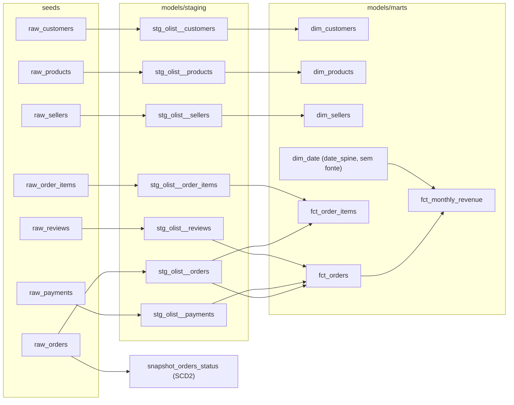

# Olist Analytics — dbt

[](https://github.com/VinnySou/dbt-olist-analytics/actions/workflows/dbt-build.yml)
📖 [Documentação e lineage gerados pelo dbt](https://vinnysou.github.io/dbt-olist-analytics/)

Transformação de dados em SQL declarativo com [dbt](https://www.getdbt.com/), sobre
o mesmo dataset (Olist, e-commerce brasileiro) do projeto
[`olist-etl-powerbi`](https://github.com/VinnySou/olist-etl-powerbi) — só que aqui a
abordagem é outra: em vez de um pipeline Python imperativo (extract/transform/load),
as transformações são modelos SQL versionados, testados e documentados pelo próprio
dbt.

**Este projeto está em construção incremental — ver [`ROADMAP.md`](ROADMAP.md)
para o que já foi feito e o que vem a seguir.**

### O que este projeto demonstra

- **Modelagem dimensional**: camada de staging (7 views, uma por fonte) →
  marts em esquema estrela (`dim_customers`, `dim_sellers`, `dim_products`,
  `dim_date`, `fct_order_items`, `fct_orders`, `fct_monthly_revenue`), com
  lógica de negócio documentada em cada model (ex.: classificação de porte
  de produto, cálculo de atraso de entrega vs. estimativa, agregação mensal
  de receita).
- **Qualidade de dados como código**: 81 testes automatizados (genéricos —
  `not_null`, `unique`, `relationships` — e de negócio, como "nenhum pedido
  com valor negativo" ou "soma dos itens bate com o pagamento"), rodando a
  cada push.
- **Histórico de mudanças (SCD2)**: `snapshot_orders_status` rastreia, via
  `dbt snapshot`, cada mudança de status de um pedido (`order_status`,
  aprovação, entrega) ao longo do tempo, com `dbt_valid_from`/`dbt_valid_to`
  — útil pra responder "em que status esse pedido estava em tal data", algo
  que a tabela de origem (sempre com o valor mais recente) não permite.
- **CI/CD**: GitHub Actions builda o projeto inteiro (`seed` + `run` + `test`)
  a cada push/PR e publica a documentação técnica automaticamente.
- **Dados sintéticos reprodutíveis**: gerador Python que recria o schema real
  da Olist sem depender de um dump de dados de produção.
- **Análises de negócio versionadas**: receita mensal, curva ABC de
  categoria e taxa de atraso por estado, como consultas SQL auditáveis em
  `analyses/`.

## Lineage

Gerado automaticamente a partir dos próprios models (`ref()`), não mantido à mão.
A versão interativa (com todas as colunas e testes) está nos
[docs publicados](https://vinnysou.github.io/dbt-olist-analytics/#!/overview);
esta é uma versão estática só com os nós principais, pra quem está lendo o
README sem clicar em nada:



## Por que dbt em vez de SQL cru (e quando não usar)

dbt brilha quando a transformação é toda dentro de um banco/warehouse (SQL puro,
com `ref()` resolvendo a ordem de execução, testes declarativos e documentação
gerada automaticamente a partir do próprio código). Não é a ferramenta certa
quando a transformação depende de lógica que SQL não expressa bem (chamadas de
API, modelos de ML, arquivos binários) — aí um pipeline Python como o
`olist-etl-powerbi` continua fazendo mais sentido.

Na prática, sem dbt o equivalente deste projeto seria uma pasta de scripts
`.sql` soltos, rodados numa ordem que só quem escreveu lembra, sem garantia de
que mudar um script não quebra os que leem a tabela que ele gera, e sem testes
além dos que alguém lembrar de rodar manualmente. Três coisas que dbt dá de
graça e um script cru não dá:

- **Ordem de execução automática**: `ref()` entre models monta o grafo acima
  a partir do próprio SQL — não existe um `run_all.sh` numerado à mão que
  alguém esquece de atualizar quando um model novo entra no meio.
- **Teste como parte do pipeline**: os 69 testes (`not_null`, `unique`,
  `relationships` e os de negócio em `tests/`) rodam dentro do mesmo
  `dbt build` que materializa os models — um dado inconsistente falha o CI
  antes de chegar a um mart, não é descoberto depois, olhando o dashboard.
- **Documentação que não fica desatualizada**: `dbt docs generate` lê as
  descrições em `schema.yml` e o grafo de `ref()` direto do código; não tem
  como o diagrama acima divergir do SQL real, porque ele é gerado a partir
  dele.

### Comparando com o `olist-etl-powerbi`

Os dois projetos partem do mesmo dataset (Olist) pra mostrar abordagens
diferentes de transformação de dados:

| | `dbt-olist-analytics` (este) | [`olist-etl-powerbi`](https://github.com/VinnySou/olist-etl-powerbi) |
|---|---|---|
| Transformação | SQL declarativo (`models/`, `ref()` resolve a ordem) | Python imperativo (pipeline ETL explícito) |
| Onde roda | Dentro do warehouse (DuckDB local neste repo) | Fora do warehouse, em memória no processo Python |
| Qualidade de dados | Testes declarativos em YAML (`dbt build` falha o CI) | Validação feita em código Python no próprio pipeline |
| Consumo final | DuckDB + docs/lineage gerados pelo dbt | Dashboard Power BI |
| Quando escolher | Transformação cabe em SQL e se beneficia de testes/docs versionados | Lógica não expressa bem em SQL (ex.: chamadas externas, formatos binários) ou o destino já é uma ferramenta de BI específica |

## Estrutura

```
seeds/                dados sintéticos (schema do dataset real da Olist)
models/staging/        um model por seed: renomeia colunas, tipa, limpa
models/marts/           dimensões e fatos prontos para consumo (esquema estrela)
scripts/                gerador dos seeds sintéticos
tests/                   testes de negócio (singular tests)
analyses/                consultas de negócio versionadas (receita mensal, curva ABC, atraso por estado)
```

## Como executar

```bash
git clone https://github.com/VinnySou/dbt-olist-analytics.git
cd dbt-olist-analytics
python -m venv .venv && source .venv/Scripts/activate   # Windows: .venv\Scripts\activate
pip install -r requirements.txt

python scripts/generate_seed_data.py
DBT_PROFILES_DIR=. dbt build
```

Roda tudo (`seed` + `run` + `test`) sobre um DuckDB local (`dev.duckdb`, ignorado
pelo git) — não precisa de nenhuma conta de warehouse na nuvem pra testar.

Para ver o grafo de dependências e a documentação gerada:

```bash
DBT_PROFILES_DIR=. dbt docs generate
DBT_PROFILES_DIR=. dbt docs serve
```

Os docs também são publicados automaticamente a cada push em `main` (workflow
`dbt-build`, job `publish-docs`), em:
**https://vinnysou.github.io/dbt-olist-analytics/**

## Stack

dbt-core · DuckDB · Python (geração dos seeds sintéticos)

---

## English

📖 [Generated docs and lineage graph](https://vinnysou.github.io/dbt-olist-analytics/)

SQL-based transformation with dbt, over the same Olist e-commerce dataset used in
[`olist-etl-powerbi`](https://github.com/VinnySou/olist-etl-powerbi) — a deliberate
contrast: that project is an imperative Python ETL pipeline, this one is declarative
SQL models with dbt's built-in testing and documentation. Work in progress, see
[`ROADMAP.md`](ROADMAP.md) for current status.

**What this demonstrates:** dimensional modeling (staging views → star-schema
marts), 81 automated data-quality tests (generic + business rules), CI/CD via
GitHub Actions (build + docs publishing on every push), reproducible synthetic
data generation, and versioned business analyses (SQL) alongside the models.

```bash
pip install -r requirements.txt
python scripts/generate_seed_data.py
DBT_PROFILES_DIR=. dbt build
```

Runs entirely against a local DuckDB file, no cloud warehouse account needed to try it.
